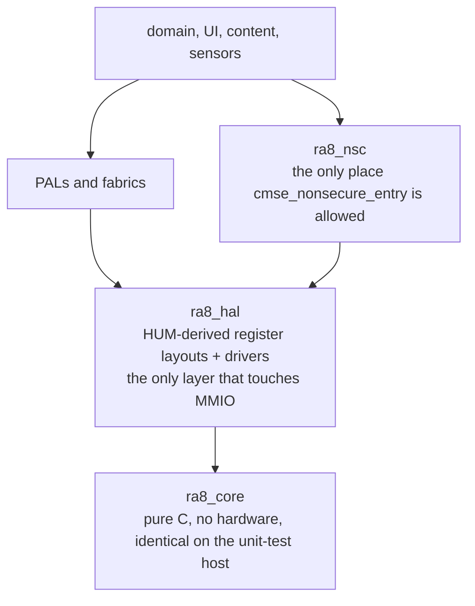

# libs/

The project's standard library: hand-written, first-party C, one directory per
library. `ra8_` is the C symbol namespace, not a directory-naming habit -- a
directory `ra8_foo/` owns the `ra8_foo_*` functions and types and the
`k_ra8_foo_*` enum values, per [`docs/STYLE_GUIDE.md`](../docs/STYLE_GUIDE.md).
`ls libs/` is the registry; nothing in this file restates it.

Two directories are exempt from the coding-style rules. `third_party/` is
vendored SOUP (Software of Unknown Provenance) and keeps its upstream
conventions; its component justifications live under
[`docs/SOUP/`](../docs/SOUP/) and MC/DC re-test is waived there. `ra8_fonts/`
carries the prefix because it owns the font blob symbols, but it is data plus a
generated header, not hand-authored code.

## Layering

Code may depend on anything lower, never on anything higher. The bottom edge is
enforced: `scripts/checks/check_core_layering.py` fails the build if anything
under `ra8_core` includes a header owned by another library. Full ring numbering
and the `{World: S/NS/NSC}` TrustZone tag every Ring-3+ file carries are in
[`docs/RING_AND_WORLD.md`](../docs/RING_AND_WORLD.md).

## The families above the HAL

A library's own file-header `@par Tag` is authoritative for its ring and world.
The grouping below is a reading aid for someone opening `ls libs/` for the
first time.

- **Foundation and hardware.** Error codes, logging, time, the pin validator
  and the fault handlers; the register headers derived from the Hardware User's
  Manual and every peripheral driver over them; the MPU, the TrustZone veneers
  and secure boot; and one board-support directory per target board, which owns
  that board's pinout so no app hand-encodes a pin.
- **I/O, storage and networking.** A peripheral-agnostic I/O fabric that
  everything storage-shaped goes through, the filesystem and flash-translation
  layers under it, platform abstraction layers below the vendored Ethernet, USB
  and display stacks, and a single boundary library to the companion radio.
- **Memory.** Zero-heap arenas, slabs and caches. Nothing above them allocates.
- **Content pipeline.** Markup and image decoding, reflow and pagination, the
  compiled-book containers, and the comic and long-strip readers.
- **UI.** The interaction core, the widget tree, allocation-free box-model
  layout, and the application framework the shell is built from.
- **Capture and sensors.** Camera, audio and IMU facades, each with its
  concrete device driver behind an injected seam rather than compiled in.
- **System services.** The DFU bootloader core, OTA orchestration, the watchdog
  supervisor, and the power and battery policies.

## Coupling maps

Who actually includes whom, derived from the `#include` edges between `libs/`
and `port/` -- not from the CMake graph, which cannot answer it (every
`libs/*/CMakeLists.txt` is a no-op and consumers glob the sources into one
object library). The number on each arrow is how many files carry that edge.

- [I/O fabric](../docs/diagrams/io_fabric.svg) -- `ra8_io` and the adapters above it, down to `ra8_fs` and the SD driver.
- [Book pipeline](../docs/diagrams/book_pipeline.svg) -- EPUB and comics into a paged container; the densest cluster in the tree.
- [Display and render](../docs/diagrams/display_render.svg) -- The widget/reflow stack, and the display PAL that shares no edge with it.
- [Networking](../docs/diagrams/networking.svg) -- Everything converging on `ra8_c6link`, the one boundary to the radio.
- [Memory hierarchy](../docs/diagrams/memory_hierarchy.svg) -- Arenas and caches, and the libraries that reach for them.
- [Security and TrustZone](../docs/diagrams/security_tz.svg) -- The NSC veneers, the secure app, and the DFU/root-of-trust chain.
- [Audio and camera](../docs/diagrams/audio_camera.svg) -- Sparse on purpose: the transports arrive as injected vtables.

The whole system, cores and all, is in
[`docs/diagrams/system_map.svg`](../docs/diagrams/system_map.svg).

## Portability

Which libraries would survive a port to another MCU (TI, ESP32-C, RX72N): the
audit behind RA8FW-618 slice 1. Classes come from the import edges, not from
intent. `portable` imports nothing outside `ra8_core` and the other portable
libraries. `port-through-interface` touches hardware only through an interface
that lives in a non-portable home today, so it is one seam move from portable.
`RA8-only` carries a direct HAL, NSC, board, MPU, TrustZone or cache
dependency, or is itself a per-chip implementation of an `if_` interface. The
last column names the edge that sets the class. Audited at dev 6445af918; the slice 2 build gate (RA8FW-618) enforces the
`portable` rows against drift. Run it with `just checks::portability` (or
`python3 tools/check_portability.py`, `RA8_ZIG` picks the toolchain): it
re-reads this table as the source of truth, rejects any portable row whose
include or import names a non-portable library or a vendor SDK header (FSP,
BSP, CMSIS), ast-checks every Zig source under the portable rows, and compiles
the portable C rows for the host, riscv32 (ESP32-C) and thumbv7em
(TI / Cortex-M4). Freestanding targets compile against a minimal libc-header
shim in tools/portability_gate_libc; a real port supplies its own libc, so the
gate checks ISA/semantics portability, not libc availability. Semantic Zig
cross-target builds arrive with slice 5 (RA8FW-976, the proof port).

| Library | Class | Decided by |
|---|---|---|
| `if` | portable | ra8_core only; this directory is the seam itself |
| `ra8_app` | portable | ra8_core, ra8_widget |
| `ra8_batt` | portable | ra8_core only |
| `ra8_box` | portable | ra8_core, ra8_ui |
| `ra8_c6link` | portable | ra8_core only; transport arrives as injected vtables |
| `ra8_cache_store` | portable | ra8_core only; software cache, not the chip cache controller |
| `ra8_core` | portable | no library imports |
| `ra8_devcfg` | portable | ra8_core only |
| `ra8_epd_cal` | portable | ra8_core only |
| `ra8_fmt` | portable | ra8_core only |
| `ra8_fonts` | portable | no library imports; font blob plus a generated header |
| `ra8_fs` | portable | ra8_core only |
| `ra8_gfx` | portable | ra8_core only |
| `ra8_imgdec` | portable | ra8_core, ra8_mem |
| `ra8_jpeg` | portable | ra8_core, ra8_imgdec |
| `ra8_keyboard` | portable | ra8_core, ra8_ui |
| `ra8_mem` | portable | ra8_core only |
| `ra8_modem_at` | portable | ra8_core only; UART arrives as injected vtables |
| `ra8_net_pal` | portable | ra8_core only; the vendored NetX stack above it is itself portable |
| `ra8_net_policy` | portable | ra8_core only |
| `ra8_num` | portable | no library imports |
| `ra8_ota` | portable | ra8_core only |
| `ra8_power_profile` | portable | ra8_core only |
| `ra8_psa_crypto` | portable | ra8_core only |
| `ra8_rot` | portable | no import edges; boot glue arrives as linked symbols |
| `ra8_rot_launch` | portable | no import edges; boot glue arrives as linked symbols |
| `ra8_rpc` | portable | no import edges; transport arrives as injected vtables |
| `ra8_rpc_tx` | portable | no import edges; transport arrives as injected vtables |
| `ra8_sdfont` | portable | ra8_core only |
| `ra8_sdmmc_spi` | portable | ra8_core, ra8_fs; the SPI bus arrives as an injected handle |
| `ra8_secure_app` | portable | ra8_core only |
| `ra8_tls` | portable | ra8_core only |
| `ra8_touch_cal` | portable | ra8_core only |
| `ra8_ui` | portable | ra8_core only |
| `ra8_wdt_supervisor` | portable | ra8_core only |
| `ra8_widget` | portable | ra8_core, ra8_ui, ra8_box |
| `ra8_wifi` | portable | ra8_core, ra8_c6link |
| `ra8_xml` | portable | ra8_core only |
| `if_ra8_vfs` | port-through-interface | composes portable ra8_fs; inherits ra8_io's block backends |
| `ra8_audio` | port-through-interface | capture core is seam-injected; the in-tree PDM source adapter imports ra8_pdm from ra8_hal |
| `ra8_camera` | port-through-interface | capture core is seam-injected; the in-tree CEU source adapter imports ra8_ceu from ra8_hal |
| `ra8_camera_io` | port-through-interface | ra8_camera and ra8_io's stream seam |
| `ra8_ftl` | port-through-interface | ra8_io's blockdev seam only |
| `ra8_lsm6dso` | port-through-interface | only the house ra8_i2c_bus_ops_t seam, whose header lives in ra8_hal today |
| `ra8_ov5640` | port-through-interface | only the house ra8_i2c_bus_ops_t seam, whose header lives in ra8_hal today |
| `if_ra8_cgc` | RA8-only | the per-chip clock interface implementation; imports ra8_hal |
| `if_ra8_gpt` | RA8-only | the per-chip timer/pwm implementation; programs GPT registers directly, no HAL dep |
| `ra8_board_ek_ra8d2` | RA8-only | board pinout over ra8_hal drivers |
| `ra8_board_ra8p1` | RA8-only | board pinout over ra8_hal, ra8_mpu, the cache controller |
| `ra8_dfu` | RA8-only | ra8_usb device driver from ra8_hal |
| `ra8_dfu_device` | RA8-only | ra8_dfu plus the ra8_usb driver |
| `ra8_display_pal` | RA8-only | ra8_glcdc driver from ra8_hal |
| `ra8_hal` | RA8-only | the MMIO layer itself |
| `ra8_io` | RA8-only | hosts the blockdev/stream seams but its backends include ra8_hal (xspi, sdhi, spi) |
| `ra8_mpu` | RA8-only | RA8 MPU |
| `ra8_nsc` | RA8-only | the NSC veneer layer over ra8_hal and the board |
| `ra8_tz_secure_boot` | RA8-only | TrustZone secure boot over ra8_hal |
| `ra8_usb_pal` | RA8-only | ra8_usb driver from ra8_hal |

Findings the port work should act on:

- `ra8_i2c_bus_ops.h` and `ra8_spi_bus_ops.h` live in `ra8_hal/inc`, and
  `ra8_io`'s blockdev/stream ops are the other half of the seam. Consumers
  that only touch these (`ra8_lsm6dso`, `ra8_ov5640`, `ra8_ftl`) are one
  header move from portable; homing the seam headers in `libs/if` is slice 3
  work.
- The capture facades keep their drivers behind injected seams, but the
  in-tree PDM and CEU source adapters import HAL types in public headers, so
  the libraries fail an import gate until the adapters move out.
- `ra8_rot`, `ra8_rot_launch`, `ra8_rpc` and `ra8_rpc_tx` carry no import
  edges at all; their transport and boot glue arrives as linked symbols, so
  the compile gate, not the import scan, is what proves them.

## Adding one

A new top-level directory is warranted when the code is a genuinely new library
boundary -- its own symbol namespace, its own ring and world, and a reason no
existing library should absorb it. Hardware-specific code with nothing new
architecturally is a HAL driver: add files under `ra8_hal/`. When you do add
one, tag every file's header per
[`docs/RING_AND_WORLD.md`](../docs/RING_AND_WORLD.md) and give every exported
symbol the `ra8_foo_*` naming. Do not add it to a list in this file, and never
write a running total of libraries anywhere -- both rot the day the next one
lands.
